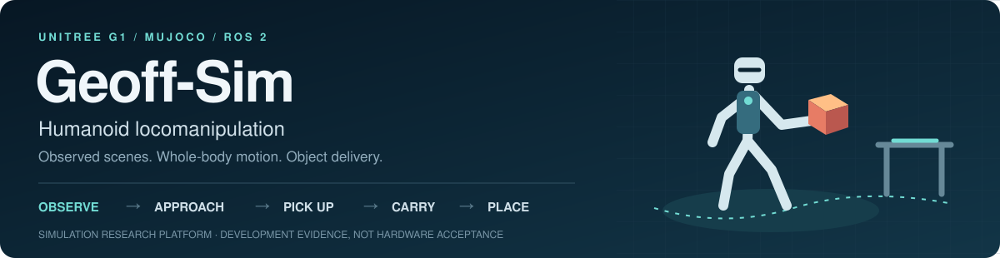
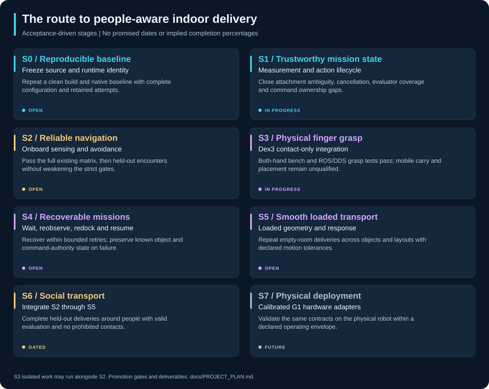

<div align="center">
  
  <p><strong>Unitree G1 · MuJoCo · ROS 2 Humble · Onboard social navigation</strong></p>
  <a href="https://github.com/DavidBatty95/Geoff-Sim/actions/workflows/verification.yml"></a>
<!-- geoff-nav:start -->
<p align="center">
  <a href="README.md"></a>
  <a href="README.md#quick-start"></a>
  <a href="docs/DEMO_GUIDE.md"></a>
  <a href="docs/INDEX.md"></a>
  <a href="docs/REPOSITORY_GUIDE.md"></a>
  <br>
  <a href="docs/PROJECT_STATUS.md"></a>
  <a href="docs/PROJECT_PLAN.md"></a>
  <a href="docs/RESULTS_REVIEW.md"></a>
  <a href="docs/literature_review/README.md"></a>
  <a href="docs/DEVELOPMENT.md"></a>
</p>
<!-- geoff-nav:end -->
</div>

Geoff-Sim is a simulation research platform for locomotion, online mapping,
human-aware navigation and reproducible avoidance experiments.

**Current status:** the onboard pipeline and visual demonstrations run, but
collision-free navigation is not yet reliable. Published datasets include
collisions, incomplete goals and invalid attempts. Historical oracle results
and unscored visual sessions are labelled separately.

**Project update — 6 October 2026:** the hardware-facing fidelity pass adds
canonical G1 topics with valid command CRCs, measured sensor-site IMUs, portable
point-cloud decoding and an articulated BrainCo interface probe. The recorded full build/test suite passed;
the latest unchanged-code zero-person **two-cube/four-table** pair completed both
deliveries. The latest retained full navigation matrix, v84, remains **10/18**;
crowd acceptance is still open. [Hardware fidelity and measured limits](docs/HARDWARE_FIDELITY.md) ·
[Read the status and progression](docs/PROJECT_STATUS.md) ·
[Follow the forward plan](docs/PROJECT_PLAN.md).

**12 October performance follow-up:** smoother nominal motion and camera-aware
exploration have completed zero-person medium-building deliveries, including a
202.48-second red → blue trial. Other tasks and crowded runs retain failures.
[Implementation, validation and remaining limits](docs/PERFORMANCE_IMPLEMENTATION_20261012.md).

**14 October reliability checkpoint:** dependency pins and experiment accounting
are aligned; compositor output publication is serialized with control-state
changes, and navigation/inspection braking now fails explicitly when measured
settling is unavailable. The integrated build passed 744 ROS test results,
142 orchestration tests and 12 native CTests. Repeatable native delivery and
crowd acceptance remain open; the delay-trained cycle-06 policy is not promoted.
[Current implementation and next steps](docs/PERFORMANCE_FOUNDATION.md).

## Explore Geoff-Sim

| Capability | What you can explore |
| --- | --- |
| **Humanoid locomotion** | A checksum-pinned Unitree G1 policy, command-response measurements and stop diagnostics |
| **Onboard navigation** | Simulated LiDAR, IMU and encoders driving localization, online SLAM and observed-free goals |
| **Human-aware planning** | Person tracking, motion prediction, route selection and collision supervision |
| **Representative worlds** | Six procedural environments plus the original pedestrian plaza |
| **Reproducible experiments** | Seeded trials, strict result validation, source-linked datasets and a browser dashboard |
| **Experimental transport** | RGB-D pickup, physically positioned arms, magnetic attachment and payload-aware locomotion |

Start with the [demo walkthrough](docs/DEMO_GUIDE.md) for a guided tour, or the
[documentation index](docs/INDEX.md) for implementation and research references.

## Explore the resource library

[](docs/resources/README.md)

Browse [eight topic collections](docs/resources/README.md#browse-by-topic) with
clickable pictures and annotated links to demos, perception/navigation, locomotion
and manipulation, experiments, research, upstream tools, development and history.
The [paper archive](docs/resources/RESEARCH.md) groups all 50 bibliography entries
by research topic; the [historical collection](docs/resources/HISTORY.md) connects
earlier notes to their current guides.

For external references, open the
[online tutorials, repositories and libraries directory](docs/resources/SIMULATION.md):
ROS 2 Humble learning paths, package APIs, Nav2, MoveIt, MuJoCo, Unitree, training,
perception and diagnostic tools—all grouped on one page.

## Recorded demo gallery

### Pedestrian plaza: simulation and onboard decisions

| MuJoCo crowd | RViz perception and planning |
| --- | --- |
|  |  |

### Representative environments

| Residential courtyard | Courtyard sensing and planning |
| --- | --- |
|  |  |

<p align="center">
  
  <br><em>Station entrance — one of six procedural benchmark worlds.</em>
</p>

All five previews are recorded visualizations. They illustrate the scene and
viewer outputs, not collision-free endurance or the performance of the latest
controller. See the [media catalogue](docs/MEDIA.md) for provenance and the
[visual runbook](docs/ONBOARD_VISUAL_DEMO.md) to launch your own session.
The SVG diagrams below are architectural schematics.

## Quick start

Supported host: x86-64 Ubuntu/Debian Linux, Docker Compose v2, `/dev/dri`, and an
X11/XWayland display. ROS Humble and MuJoCo run in the container. NVIDIA support
is optional for training. Installation needs internet access and host privileges.

```bash
git clone --recurse-submodules https://github.com/DavidBatty95/Geoff-Sim.git
cd Geoff-Sim
./install.sh
./scripts/run_onboard_navigation_demo.sh
```

The convenient daily entry point is `./geoff`:

```bash
./geoff worlds
./geoff demo plaza
./geoff demo cafe --people 4 --duration 300 --fast-start
./geoff demo clinic --people 4 --duration 300 --fast-start
./geoff results
```

The experimental magnetic transport demo has repeated complete native dual-cube
deliveries with a locally trained, native-inertial/delay-aware payload policy.
See [the current checkpoint, retained failures and command](docs/NATIVE_PAYLOAD_CONTRACT.md).
Checkpoints are local training artifacts; this is separate from crowd-navigation
and contact-only grasp acceptance.

To inspect the articulated-hand hardware-facing profile after building:

```bash
python3 scripts/run_hardware_parity_probe.py \
  --output vendor/mjlab/logs/my_hardware_probe/interfaces.json --duration 20
```

This checks live message contracts and measured sensor delivery. The
[fidelity guide](docs/HARDWARE_FIDELITY.md) lists the standard topics, BrainCo
Stark adapter, model differences and reduced sensor bandwidth.

The installer initializes pinned sources, applies the reviewed [source patches](patches/README.md),
builds dependencies and generates pedestrian animation/world assets. The official
Unitree policy is downloaded and checksum-verified. Fork access may require your
GitHub credentials. After a first Docker installation, log out/in to activate
Docker group membership. See `./install.sh --help` for managed-host options.


## Run the visual demo

```bash
./scripts/run_onboard_navigation_demo.sh --duration 1800 --people 8 --seed 44
# Reuse a completed build for a shorter session:
./scripts/run_onboard_navigation_demo.sh --fast-start --duration 120 --people 4
```

MuJoCo shows relaxed-arm walking actors and a viewer-only goal ring. RViz shows
online SLAM, measured LiDAR, tracks, predictions, route candidates and the final
command. Visual goals hand off within 0.5 m. Sessions log contacts and may restart
after falls/data loss; they are **unscored**. Only run one simulator at a time.

For a step-by-step explanation of both viewers, expected behavior, stopping a
session and finding its logs, see the [demo guide](docs/DEMO_GUIDE.md).

## Results GUI and avoidance dataset

The local browser GUI needs only Python 3; it does not need ROS or Docker to
inspect published results.

```bash
python3 scripts/avoidance_results_gui.py
# Open http://127.0.0.1:8765

# Inspect the separately labelled earlier demo evidence:
python3 scripts/avoidance_results_gui.py --dataset docs/results/demo_results.json --port 8766
```

Filter/search runs, compare per-world goal completion, inspect contacts, near
misses, clearance, duration and source hashes, and download CSV. Invalid attempts
remain visible. See [worlds and dataset methodology](docs/AVOIDANCE_EXPERIMENTS.md).


| World | Interior dimensions | Challenge |
| --- | --- | --- |
| `small_open` / `courtyard` | 8 × 8 m | Residential courtyard, doors, windows and wall lights |
| `small_clutter` / `cafe` | 8 × 8 m | Café courtyard, tables and planted tree |
| `medium_open` / `station` | 12 × 10 m | Station entrance, circulation markings and strip lighting |
| `medium_doorway` / `clinic` | 12 × 10 m | Clinic partitions, glazing and a 2 m doorway |
| `large_pillars` / `concourse` | 16 × 14 m | Station concourse, columns and platform signage |
| `large_office` / `office` | 16 × 14 m | Office lobby, partitions and wooden seating |

The world IDs remain stable for dataset comparison. Representative-v2 scenes
add original procedural surfaces, façades, furnishings and signage; simple-v1
baseline results remain separately labelled. These are stylized, human-scale
simulation environments rather than surveyed digital twins.

```bash
# Build once before collecting new runs:
docker compose run --rm unitree-g1-sim /workspace/scripts/build_unitree_mujoco.sh
# 18 serial trials: six worlds × three seeds, four people, three goals each:
python3 scripts/run_avoidance_matrix.py
# Export published measurements:
python3 scripts/avoidance_results_gui.py --export docs/results/avoidance_dataset.csv
```

The matrix refreshes the ROS/MuJoCo build once (or reuses it with `--fast-start`), uses onboard-only
navigation and retains failed trials. It writes raw artifacts under the ROS
workspace's ignored results directory and publishes a portable JSON dataset.

## Scored and diagnostic runs

```bash
./scripts/run_demo_suite.sh --case onboard-waypoints --goals 3 --people 8 --seed 44 --headless --fast-start
./scripts/run_demo_suite.sh --case fixed-forward --headless --fast-start
./scripts/run_demo_suite.sh --suite quick --headless
```

`--headless` suppresses RViz; the standalone MuJoCo viewer may still need X11.
The mock benchmark verifies mechanics and is not locomotion/perception evidence.
The current strict mock acceptance gate can fail; do not relax it to conceal a
regression. [Demo suite](docs/DEMO_SUITE.md) · [Recorded results](docs/DEMO_RESULTS.md).

## Architecture


The onboard configuration uses simulated LiDAR, IMU and encoders for scan
odometry and online SLAM. Navigation goals come from observed free space.
LiDAR tracking and constant-velocity predictions feed event-driven replanning,
social trajectory selection and the final collision supervisor. The ONNX policy
converts safe commands into 29-joint targets over Unitree DDS.

Simulator truth is isolated to scoring/diagnostics. Actors plan around static
geometry and other actors independently of the robot. In generated worlds,
world geometry constrains actor motion; it is not supplied as a navigation map.


The onboard demo uses forward/lateral command limits of 0.65/0.45 m/s with
2.40 m/s² software acceleration. These are simulation settings, not validated
hardware limits. See [architecture](docs/ARCHITECTURE.md) and [source boundaries](docs/ONBOARD_SOCIAL_NAVIGATION.md).

Route following prefers turning toward the route before walking forward. The
onboard profile uses bounded pivot commands; short final-goal adjustments
and avoidance escapes may still use lateral movement. See [script entry points](scripts/README.md).
The official-policy demos use the same joint-action settings as the response
tests; forward/lateral command slew and low-level command validation remain active.

## Evidence and research

The investigation and payload reports describe dated development snapshots.
The corresponding controller, transport tools and reviewed simulator patches
are included in the repository. Locally trained checkpoints remain separate
artifacts; reproduction requires the explicit policy identified in each report.

| Evidence track | Recorded scope | Read more |
| --- | --- | --- |
| Published representative-world cohort (`calibrated-actions-v12`) | 4/18 strict passes, 19/54 goals, 12 contacts | [Published demo evidence](docs/DEMO_RESULTS.md) |
| Navigation investigation, consolidated v82 cohort | 14/18 strict passes, 49/54 goals, four contacts; navigation acceptance remains unmet | [Investigation and iteration ledger](docs/NAVIGATION_RELIABILITY_INVESTIGATION.md) |
| Later complete matrix (v84) and alignment audit (v85) | v84: 10/18 strict passes, 46/54 goals, six contacts; v85 confirms geometric overlaps in audited failures | [Current evidence snapshot](docs/PROJECT_STATUS.md#current-evidence) |
| Payload-policy fixture | Two consecutive complete zero-person transport runs; 2 complete passes among 11 recorded native candidate attempts with evolving integration code | [Training and transport evidence](docs/PAYLOAD_POLICY_TRAINING.md) |
| Research gaps and literature review | 74-page fundamentals-to-novelty review; 50 appraisals, with 46 selected full-text inspections; five intended research gaps | [Research goals and complete PDF](docs/literature_review/README.md) |

These records cover different configurations and evaluation conditions. The
[results-review guide](docs/RESULTS_REVIEW.md) explains how to inspect provenance,
failures and metrics before making comparisons. The research review distinguishes
implemented capabilities from proposed contributions and documents the depth of
reading for each source.

## Project progression and next steps


The project has progressed from simulator integration and oracle demonstrations
to sensor-driven experiments, inspectable failure datasets and experimental
payload transport. Each phase has its own configuration and evidence; the
timeline is a development history rather than a claim of steadily improving
performance. [Detailed timeline and current status](docs/PROJECT_STATUS.md).

The next reactivity work targets end-to-end latency, command ownership, fast
collision response and measured stopping behaviour. The
[R1–R6 workstream](docs/PROJECT_PLAN.md#reactivity-workstream) defines the tests
and promotion gates, including a controlled comparison with Grove-G1's locomotion
backend. These are planned improvements, not new performance claims.

<details>
<summary><strong>View the forward roadmap: reproducibility → reliable navigation → people-aware delivery</strong></summary>



The [project plan](docs/PROJECT_PLAN.md) provides deliverables, dependencies,
completion criteria and an update process for every stage. The
[technical roadmap](docs/SOCIAL_LOCOMANIPULATION_ROADMAP.md) retains the detailed
implementation ledger. Dates are recorded for completed work; future stages are
ordered by evidence requirements rather than promised delivery dates.

The [P0–P7 research programme](docs/RESEARCH_PROGRAMME.md) maps the five literature
gaps to controlled experiments, baselines and candidate papers. It starts with
calibrated observation-to-execution planning and causal diagnosis, then develops
distinct coordination, articulated-risk and human-evaluation studies where justified.

</details>

## Repository map


**New to the codebase?** Use the [folder-by-folder guide](docs/REPOSITORY_GUIDE.md)
for an annotated tree, package responsibilities, edit locations and artifact
boundaries. The [ROS workspace README](ros2_ws/src/README.md) maps individual packages.

| Path | Contents |
| --- | --- |
| [`ros2_ws/src/`](ros2_ws/src/) | ROS 2 bridge, bringup, messages, manipulation and benchmark packages |
| [`scripts/`](scripts/README.md) | Demo launchers, experiment tools, diagnostics and verification |
| [`docs/`](docs/INDEX.md) | User guides, architecture, research and portable results |
| [`patches/`](patches/README.md) | Reviewed modifications to pinned upstream sources |
| [`docker/`](docker/README.md) | Container runtime and dependency definitions |
| [`tools/`](tools/README.md) | Results-dashboard frontend |
| [`.github/`](.github/) | Verification workflow, dependency updates and contribution templates |
| [`integrations/`](integrations/README.md) | Optional integration profiles and runtime boundaries |
| [`vendor/`](vendor/) | External sources, including the optional MJLab training environment |
| [`archive/`](archive/README.md) | Historical proposals and experiment notes |

## Development and contributing


- [Documentation index](docs/INDEX.md)
- [Project status and progression](docs/PROJECT_STATUS.md) · [Detailed forward plan](docs/PROJECT_PLAN.md)
- [Development and checks](docs/DEVELOPMENT.md)
- [Changelog](CHANGELOG.md) · [Release and artifact policy](docs/RELEASES.md)
- [Maintainer guide and GitHub settings](docs/MAINTAINER_GUIDE.md)
- [Team handoff and remaining work](docs/HANDOFF.md)
- [Training and calibration tools](docs/TRAINING_AND_CALIBRATION.md)
- [Contributing](CONTRIBUTING.md) · [Code of conduct](CODE_OF_CONDUCT.md) · [Security reporting](SECURITY.md) · [Existing licenses](LICENSES.md)
- [Archived research drafts](archive/README.md)

Existing package/upstream licenses are preserved. A root-license decision and
third-party asset redistribution provenance remain owner decisions. Repository
branch protections, fork access and private vulnerability reporting require the
GitHub owner's configuration; the [maintainer guide](docs/MAINTAINER_GUIDE.md)
documents the exact setup.

## Citing Geoff-Sim

Use GitHub's **Cite this repository** entry or [`CITATION.cff`](CITATION.cff), and
identify the exact commit/tag, policy and experiment dataset used. Cite the
relevant [upstream research](docs/resources/RESEARCH.md) separately. The
[release guide](docs/RELEASES.md) explains version and artifact provenance; local
training checkpoints are not automatically included in a source checkout.
