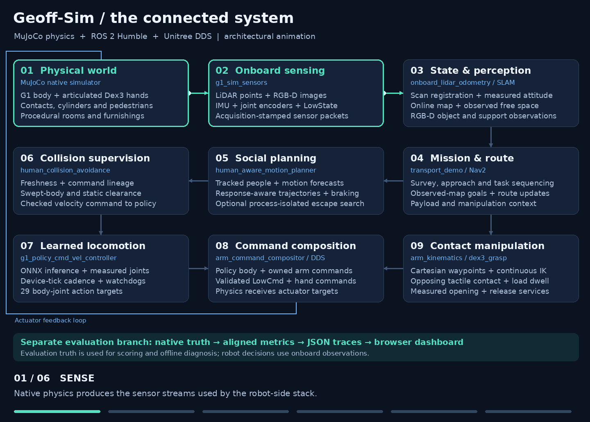
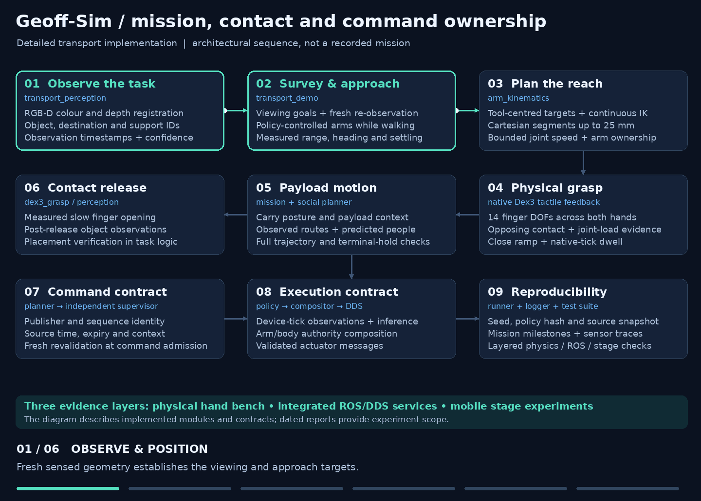
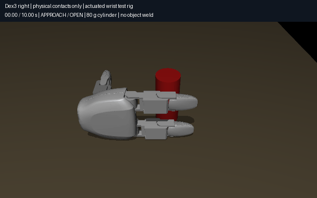
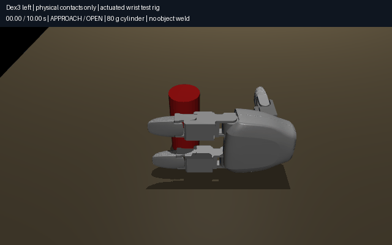

<div align="center">
  
  <p><strong>Unitree G1 · MuJoCo · ROS 2 Humble · Sensor-driven robotics</strong></p>
  <p>A connected research platform for humanoid locomotion, perception, social navigation and dexterous manipulation.</p>
  <a href="https://github.com/DavidBatty95/Geoff-Sim/actions/workflows/verification.yml"></a>
<!-- geoff-nav:start -->
<p align="center">
  <a href="README.md"></a>
  <a href="README.md#quick-start"></a>
  <a href="docs/DEMO_GUIDE.md"></a>
  <a href="docs/README.md"></a>
  <a href="docs/REPOSITORY_GUIDE.md"></a>
  <br>
  <a href="docs/PROJECT_STATUS.md"></a>
  <a href="docs/PROJECT_PLAN.md"></a>
  <a href="docs/RESULTS_REVIEW.md"></a>
  <a href="docs/literature_review/README.md"></a>
  <a href="docs/DEVELOPMENT.md"></a>
</p>
<!-- geoff-nav:end -->
</div>

## Project overview

**Geoff-Sim brings a complete robotics research workflow into one repository:**
physical simulation, onboard sensing, online mapping, learned locomotion,
human-aware motion planning, articulated hands, repeatable experiments and
visual results analysis.

The project connects a Unitree G1 to ROS 2 through native DDS interfaces. A
sensor-driven stack builds its view of the world from LiDAR, IMU, encoders and
RGB-D observations, then turns task intent into checked motion and manipulation
commands. Procedural environments and walking pedestrians make the platform a
rich setting for studying embodied behaviour.

**Development wrap-up · October 2026.** The core development phase is wrapped up.
This repository is preserved as a reproducible research and engineering reference,
with working tools, recorded demonstrations, source-linked experiments and a
detailed technical library. Future updates are expected to be occasional.

## What has been achieved

| Area | Project achievement |
| --- | --- |
| **Integrated humanoid simulation** | Native MuJoCo physics, a 29-joint body-policy interface, articulated Dex3 hands and Unitree DDS command/state exchange |
| **Sensor-driven autonomy** | Simulated LiDAR, IMU, joint encoders and RGB-D feeding scan odometry, online SLAM, object observations and observed-map navigation |
| **Human-aware motion** | Person tracking, trajectory forecasts, event-driven route updates, response-aware local planning and an independent collision supervisor |
| **Physical hand manipulation** | Both Dex3 hands demonstrate contact-based grasp, lift, hold and release; native tactile feedback is integrated with ROS services |
| **Task orchestration** | Survey, approach, reach, grasp, payload-motion and release modules, with explicit command ownership and measured-state transitions |
| **Representative environments** | Six procedural courtyard, café, station, clinic, concourse and office worlds, plus the original pedestrian plaza |
| **Experiment infrastructure** | Seeded runners, source snapshots, policy checksums, timestamped traces, offline replay and an interactive results dashboard |
| **Research and documentation** | A 74-page literature review, 50 paper appraisals, architecture guides, implementation notes and an annotated resource library |

### Selected milestones

- **Physical Dex3 grasp/release through ROS and DDS:** minimum held lifts of
  **14.73 cm right / 14.48 cm left** in the integrated service tests.
- **Complete physical hand-bench recordings:** both hands perform the full
  approach → close → lift → hold → lower → release sequence shown below.
- **Sensor-driven search and task sequencing:** the historical magnetic-fixture
  exploration cohort completed **4/4 colour tasks**, followed by a medium-building
  delivery demonstration.
- **Onboard survey diagnostics:** both latest three-person seed-42/43 surveys
  complete the object-and-destination discovery stage.
- **Automated verification:** **1,016 ROS test results**, **246 orchestration tests**
  and **13 native CTests** pass in the latest local workspace run. The pinned
  MuJoCo hand-physics suite has a recorded **16-test pass**.

Each milestone has its own experiment configuration and scope. Explore the
[project record](docs/PROJECT_STATUS.md), [contact-manipulation evidence](docs/DEX3_CONTACT_MANIPULATION_20261020.md)
and [published experiment records](docs/results/README.md) for the associated
measurements and provenance.

## Architecture

### The connected system

The animation follows data through the implemented stack, from native physics
and sensor acquisition to state estimation, planning, supervision and actuation.
The separate evaluation branch makes every experiment inspectable.



[Open full-size static diagram](docs/media/architecture-system.png) ·
[Detailed architecture guide](docs/ARCHITECTURE.md) ·
[Onboard data-flow guide](docs/ONBOARD_SOCIAL_NAVIGATION.md)

| Layer | Main responsibilities | Interfaces and implementation |
| --- | --- | --- |
| **Physics and worlds** | Robot dynamics, articulated fingers, object contacts, pedestrian motion and procedural scenes | Native `unitree_mujoco`, reviewed [source patches](patches/README.md) |
| **Sensing** | LiDAR raycasts, RGB-D images, native IMU streams, joint measurements and device-tick feedback | `g1_sim_sensors`, sensor packets, `LowState`, `JointState` |
| **State and perception** | Scan registration, measured attitude, online mapping, RGB-D object/support observations | `onboard_lidar_odometry`, SLAM, `transport_perception` |
| **Mission and routing** | Viewing goals, search, approach, task sequencing and route updates | `transport_demo`, Nav2, observed-free goals |
| **Social planning** | Tracked-person forecasts, executable candidate trajectories, braking and optional escape primitives | `dynamic_obstacle_tracker`, `human_aware_motion_planner`, process-isolated search |
| **Supervision** | Command freshness, identity, context and swept-body clearance | `human_collision_avoidance`, command envelopes |
| **Execution** | ONNX body policy, arm ownership, joint-target composition and actuator messages | `g1_policy_cmd_vel_controller`, arm compositor, Unitree DDS |
| **Evidence** | Aligned evaluation, source-linked traces, replay, metrics and visualization | Run logger, experiment publishers, browser dashboard |

### Mission, contact and command ownership

The transport implementation connects fresh observations and measured settling
to Cartesian reaching, physical grasp feedback, payload context and controlled
finger opening. The animation also shows how command contracts and reproducible
artifacts connect those modules.



[Open full-size static diagram](docs/media/architecture-control.png) ·
[Manipulation resource collection](docs/resources/MANIPULATION.md) ·
[Hardware-facing interfaces](docs/HARDWARE_FIDELITY.md)

**Architecture animations are illustrated system models.** Their six highlighted
stages explain modules and data flow. The gallery below contains rendered physical
simulation recordings. Both diagrams have static reading copies and
[reproducible generation code](scripts/generate_architecture_gifs.py).

## Recorded demo gallery

### Complete physical Dex3 grasp runs

Each GIF shows a complete **ten-second physical hand-bench run**: approach,
close, lift, hold, lower and release an **80 g, 40 mm diameter cylinder**.
An actuated wrist fixture supplies the arm motion; finger contact and friction
support the object. Playback is real time at 10 fps, followed by an outcome card.

| Right Dex3 hand | Left Dex3 hand |
| --- | --- |
|  |  |
| **14.27 cm held lift**, opposing contacts and successful release. | **13.95 cm held lift**, opposing contacts and successful release. |

Each recording contains **101 frames spanning t=0–10 s** from actual MuJoCo
states, with free objects supported by physical finger contacts.
[Right-hand provenance](docs/media/dex3/right_complete_grasp.json) ·
[Left-hand provenance](docs/media/dex3/left_complete_grasp.json)

Explore navigation previews, earlier delivery demonstrations and recorded stages
in the [media catalogue](docs/MEDIA.md).

## Quick start

Supported host: x86-64 Ubuntu/Debian Linux, Docker Compose v2, `/dev/dri`, and an
X11/XWayland display. ROS 2 Humble and MuJoCo run inside the container; NVIDIA
support is available for training.

```bash
git clone --recurse-submodules https://github.com/DavidBatty95/Geoff-Sim.git
cd Geoff-Sim
./install.sh
./scripts/run_onboard_navigation_demo.sh
```

The installer initializes pinned sources, applies reviewed patches, builds the
workspace and generates the pedestrian/world assets. The official Unitree policy
is downloaded and checksum-verified. See `./install.sh --help` for installation
options and the [demo walkthrough](docs/DEMO_GUIDE.md) for the guided first run.

### Run the visual demo

Use the `./geoff` entry point to explore the platform:

```bash
./geoff worlds
./geoff demo plaza
./geoff demo cafe --people 4 --duration 300 --fast-start
./geoff demo clinic --people 4 --duration 300 --fast-start
./geoff results
```

MuJoCo displays the robot, articulated hands, pedestrians and scene. RViz displays
online mapping, measured LiDAR, people tracks, trajectory predictions, route
candidates and commands. Run one simulator session at a time.

The experimental mobile-manipulation entry point is:

```bash
./geoff transport --world transport_dual --task red:red --people 0
```

The [transport and testing guide](docs/DEMO_TESTING.md) describes policy artifacts,
stage diagnostics, manipulation settings and result interpretation.

## Worlds and results dashboard

| World | Dimensions | Setting |
| --- | --- | --- |
| `courtyard` / `small_open` | 8 × 8 m | Residential courtyard with doors, windows and wall lights |
| `cafe` / `small_clutter` | 8 × 8 m | Café courtyard with tables and a planted tree |
| `station` / `medium_open` | 12 × 10 m | Station entrance with circulation markings and strip lighting |
| `clinic` / `medium_doorway` | 12 × 10 m | Clinic with partitions, glazing and a 2 m doorway |
| `concourse` / `large_pillars` | 16 × 14 m | Station concourse with columns and platform signage |
| `office` / `large_office` | 16 × 14 m | Office lobby with partitions and wooden seating |

The Python-only results GUI provides filtering, per-world comparisons, trajectory
replay, source hashes and CSV export:

```bash
python3 scripts/avoidance_results_gui.py
# Open http://127.0.0.1:8765
```


[World generation and datasets](docs/AVOIDANCE_EXPERIMENTS.md) ·
[Results guide](docs/RESULTS_REVIEW.md) · [Published records](docs/results/README.md)

## Reproducibility and verification

Experiments record seeds, effective parameters, policy identity, source snapshots,
timestamped measurements and mission milestones. The layered suite connects native
physics checks, ROS/DDS integration and mobile-stage protocols.

```bash
# Workspace verification and pinned hand-physics checks:
./scripts/run_demo_suite.sh --suite validation --headless --seed 42

# Inspect the manipulation protocol and required artifacts:
./scripts/run_demo_suite.sh --suite manipulation --dry-run --headless --seed 42

# Deterministic benchmark mechanics:
./scripts/run_demo_suite.sh --suite quick --headless
```

[Suite guide](docs/DEMO_TESTING.md) · [Development checks](docs/DEVELOPMENT.md) ·
[Training and calibration](docs/TRAINING_AND_CALIBRATION.md)

## Research and resource library

[](docs/resources/README.md)

The documentation brings together **eight topic collections**, a **74-page
fundamentals-to-research review**, and **50 paper appraisals**, including 46
selected full-text inspections. It connects robotics concepts to the project's
implementation, experiments and reusable tooling.

- [Complete literature review and PDF](docs/literature_review/README.md)
- [Paper archive by research topic](docs/resources/RESEARCH.md)
- [ROS 2, MuJoCo, Unitree, Nav2 and MoveIt references](docs/resources/SIMULATION.md)
- [Annotated resource library](docs/resources/README.md)
- [Project history and development milestones](docs/PROJECT_STATUS.md)

## Project wrap-up

Geoff-Sim's lasting contribution is the connected platform: a humanoid physics
environment, an onboard perception-to-control stack, physical hand-manipulation
tools, inspectable experiments and an extensive research record. The repository
captures the engineering journey from simulator integration through sensor-driven
navigation and contact-manipulation development.

The code, diagrams, demonstrations and technical notes are preserved for learning,
reproduction and future reuse. The [handoff guide](docs/HANDOFF.md) and
[technical development record](docs/PROJECT_STATUS.md) provide a starting point
for anyone building on this work.

## Repository map

| Path | Contents |
| --- | --- |
| [`ros2_ws/src/`](ros2_ws/src/) | ROS 2 bridge, bringup, interfaces, manipulation and benchmarks |
| [`scripts/`](scripts/README.md) | Launchers, experiments, diagnostics, diagram generation and verification |
| [`docs/`](docs/README.md) | Guides, architecture, research, media and portable experiment records |
| [`patches/`](patches/README.md) | Reviewed modifications to pinned upstream sources |
| [`docker/`](docker/README.md) | Container runtime and dependency definitions |
| [`tools/`](tools/README.md) | Results-dashboard frontend |
| [`integrations/`](integrations/README.md) | Optional integration profiles |
| [`vendor/`](vendor/) | External sources and training environment |

[Folder-by-folder guide](docs/REPOSITORY_GUIDE.md) ·
[ROS package map](ros2_ws/src/README.md) · [Documentation hub](docs/README.md)

## Acknowledgements and citation

Built on the work of the Unitree, MuJoCo, ROS 2, Nav2, MoveIt and learning-based
robotics communities. Existing upstream and package licenses are preserved;
see [licenses and attribution](LICENSES.md).

Use GitHub's **Cite this repository** entry or [`CITATION.cff`](CITATION.cff), and
identify the commit, policy and dataset used. The [release and artifact guide](docs/RELEASES.md)
documents source and experiment provenance.

[Contributing](CONTRIBUTING.md) · [Code of conduct](CODE_OF_CONDUCT.md) ·
[Security reporting](SECURITY.md) · [Changelog](CHANGELOG.md)
